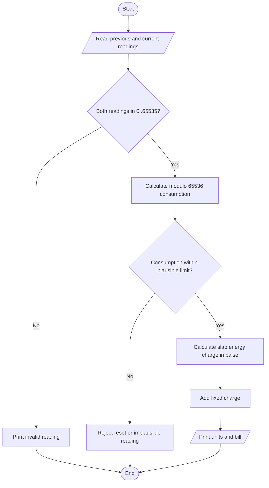

# C Programming Assignment 1 (CO1)
## Design, Implement and Validate a Reliable Billing Program for Grama Jyothi

**Student:** Varunbabu M.R.  
**Total marks:** 50  
**Compiler used for the recorded tests:** GCC 14.2.0, C11, `-Wall -Wextra -Wpedantic -Werror`  
**Money convention:** all internal monetary values are integer paise; display converts paise to rupees and paise.

> **Important measurement note:** sizes and numeric results in this report are from the Linux x86-64 GCC test environment used for the recorded runs. A Windows 64-bit MinGW environment commonly uses a different `long` size (4 bytes), so rerun the `sizeof` program on the submission computer and update that row if needed.

---

## Task 1. Understand the problem and identify the data (4 marks)

### Problem and data items

Grama Jyothi bills each household from a previous and current meter reading. The program calculates consumed units, applies the three energy slabs, adds the fixed charge, and prints a non-negative total.

| Data item | Purpose and justification | Suitable representation |
|---|---|---|
| Household number | Identifies the account. It is an identifier, not a quantity to calculate with. | `char[]` if it may contain letters/leading zeroes; otherwise a bounded integer ID. |
| Category | Identifies the tariff category, if categories are introduced. | `enum` or a short validated string. |
| Previous reading | Starting meter register value, 0 to 65,535. | 16-bit unsigned value, represented here by `unsigned short`. |
| Current reading | Latest meter register value, same range. | `unsigned short`. |
| Units consumed | Difference including one register rollover. | `unsigned int`, because a difference can exceed the maximum reading. |
| Energy charge | Charge from the slab calculation. | `long long` paise. |
| Fixed charge | Fixed ₹50 charge. | Named constant, `5000` paise. |
| Total bill | Energy charge plus fixed charge. | `long long` paise, never floating-point rupees. |
| Tariff limits and rates | Rules used to calculate a bill. | Named compile-time constants for the original design. |
| Number of households / district total | Scale and accumulated amount. | `unsigned int` for a count; `long long`/`uint64_t` for totals. |

### Inputs, outputs, constants and rules

**Inputs:** previous reading, current reading, household ID, and category. **Outputs:** units consumed, energy charge, fixed charge, and total bill. The fixed charge is ₹50; the first 100 units are free; units 101–200 cost ₹2.25 each; units above 200 cost ₹4.50 each.

The tariff rates, slab boundaries, fixed charge, meter maximum and meter modulus do not change during one run, so they are constants. Readings and units are non-negative. A bill is non-negative. The monetary values are stored as whole paise, so no fractional paise is stored. District totals can be very large, so a wider accumulator is required. A valid bill must satisfy `total = energy_charge + fixed_charge`.

### Assumptions

1. The original meter is a 16-bit unsigned register with values 0–65,535 and modulus 65,536.
2. At most one rollover occurs between two billing readings.
3. The meter reading pair alone cannot distinguish a genuine rollover from an out-of-order or reset reading. The implementation therefore uses a configurable operational plausibility limit of 10,000 units per billing period. The co-operative must replace this example limit with a value based on actual meter capacity and billing interval.
4. The fixed charge and slab tariff are the same for all households in this simplified scenario. A real category-specific tariff would require a validated category-to-tariff mapping.
5. The stated tariff is applied to each billing period without tax, subsidy, arrears or late fees, because those are outside the supplied scenario.

### Alternative: readings stored as text

A reading such as `"01530"` can be stored in a character array and converted using `strtoul`. Converting or comparing a d-digit string takes O(d) time. A fixed-width integer uses O(1) storage and supports direct arithmetic. A string requires O(d) bytes plus a terminating null character. Text preserves leading zeroes and is useful for display/import, but conversion and validation are needed before arithmetic. For this problem, integer storage is simpler and faster after input validation.

**Pseudocode**

```text
READ previous_reading, current_reading, household_id, category
VALIDATE both readings are in 0..65535
units = (current_reading - previous_reading) modulo 65536
REJECT if units exceeds the operational plausibility limit
energy_charge = slab_charge(units)
fixed_charge = 5000 paise
total = energy_charge + fixed_charge
PRINT units and total in rupees.paise format
```

**Complexity:** processing one household takes O(1) time and O(1) extra space. Processing n households takes O(n) time. Text parsing adds O(d) work per reading, where d is the number of digits.

---

## Task 2. Choose the data types (4 marks)

### Type selection and observed sizes

| Data | Type used/recommended | Observed size on test machine | Reason |
|---|---|---:|---|
| Meter register | `unsigned short` / `uint16_t` | 2 bytes | 0–65,535 when 16-bit. |
| Units consumed | `unsigned int` | 4 bytes | Can hold the modulo difference and normal usage. |
| Household count | `unsigned int` / `uint32_t` | 4 bytes | 800,000 is well within range. |
| Money per bill | `long long` paise | 8 bytes | Exact whole-paise arithmetic. |
| District accumulator | `long long` / `uint64_t` | 8 bytes | Prevents 32-bit total overflow. |
| Category | `enum` | commonly 4 bytes | Named, type-checked category values. |
| Tariff display or external input | validated character buffer | depends on input | Needed only for text input/configuration. |

The recorded environment reported `sizeof(int)=4`, `sizeof(long)=8`, `sizeof(long long)=8`, `USHRT_MAX=65535`, `INT_MAX=2147483647`, and `LLONG_MAX=9223372036854775807`. `float` has 24 bits of significand precision (`FLT_MANT_DIG=24`). The C standard guarantees minimum ranges, not identical sizes on every platform. Use `<limits.h>` and `<float.h>` on the target system rather than assuming sizes.

### Why integer paise is used

Binary floating-point cannot represent most decimal fractions exactly. Repeated addition can accumulate small errors. One observed example is adding a one-paise amount (`0.01f` rupees) 4,000 times: expected ₹40.00, but the float result was `39.999294281` (see `evidence/task_2_float_example.txt`). Integer paise gives exactly 4,000 paise = ₹40.00.

### Meter rollover and completed code

The completed `task_2.c` returns `(unsigned short)(current - previous)` without an `if-else`. Conversion back to a 16-bit unsigned type applies modulo 65,536. For 65,400 → 120, the difference is −65,280; modulo 65,536 gives 256. It is not a negative consumption. The program verifies the required examples: 1,200 → 1,530 gives 330 units; 65,400 → 120 gives 256 units.

### Alternative: `double` rupees

A `double` implementation could calculate rupees and round to two decimal places at the billing boundary. Addition is O(1) and storage is usually 8 bytes, just like `long long`, but binary fractions still cannot represent every decimal amount exactly. If each of n bills has a small representation error εᵢ, the accumulated error can grow approximately with the sum of the absolute errors. Integer paise has exact addition as long as the accumulator does not overflow.

**Evidence:** `evidence/task_2_output.txt`, `evidence/task_2_types_output.txt`, `evidence/task_2_float_example.txt`.

---

## Task 3. Define the constants (3 marks)

The tariff values are defined once at the top of `task_3.c`: slab boundaries 100 and 200 units, rates 0/225/450 paise, and fixed charge 5,000 paise. The calculation uses only these named constants. `RATE2_PAISE` is guarded by `#ifndef`, allowing a build-time override for the tariff revision experiment.

| Method | Type checking / scope | Debugging | Appropriate use |
|---|---|---|---|
| `#define` | Text substitution; no C type or block scope | Macro name is replaced before compilation | Compile-time limits and configurable build constants. |
| `const` variable | Has a C type and normal scope | Visible as a variable in a debugger | Typed values, especially local or runtime-selected values. |
| `enum` | Integer constant with named values | Names may be visible in debug information | Small sets of related integral choices, such as categories. |

Constant names use uppercase words separated by underscores. A macro uses no storage by itself. A `const` object may occupy storage depending on its use and compiler. Runtime performance is normally unaffected when the compiler can fold either form.

### Test results

| Units | Default rate ₹2.25 | Revised rate ₹2.30 |
|---:|---:|---:|
| 0 | ₹50.00 | ₹50.00 |
| 100 | ₹50.00 | ₹50.00 |
| 150 | ₹162.50 | ₹165.00 |
| 200 | ₹275.00 | ₹280.00 |
| 350 | ₹950.00 | ₹955.00 |

The revised run was compiled using `gcc -DRATE2_PAISE=230 task_3.c`. Every bill containing slab-2 units changes consistently; bills of 100 units or less do not change. Evidence: `evidence/task_3_output.txt` and `evidence/task_3_rate230_output.txt`.

**Complexity:** the fixed slab formula uses O(1) time and O(1) space per bill.

---

## Task 4. Use macros safely (4 marks)

`RUPEES_TO_PAISE`, `SQUARE` and `MAX` are fully parenthesised. Parentheses make `SQUARE(5 + 1)` expand to `((5 + 1) * (5 + 1))`, producing 36. Without parentheses, `x*x` would expand with incorrect operator precedence.

The `MAX(a,b)` macro can evaluate an argument more than once. In the test, `MAX(side_effect_i++, 10)` evaluates `side_effect_i++` once in the comparison and again in the selected expression when the comparison is true. The starting value 12 becomes 14. Do not pass expressions with side effects to such macros.

`static inline` functions `square_inline` and `max_inline` are safer because each argument is evaluated once and the compiler can inline the function. A macro can increase executable code size because its expanded body is repeated at each of k call sites; an inline function may share one body or be inlined by the compiler. Both have O(1) work for these operations; exact call overhead and code size depend on compiler optimisation.

`gcc -E task_4.c -o evidence/task_4_preprocessed.i` shows the macro expansion before compilation. Evidence: `evidence/task_4_output.txt` and `evidence/task_4_preprocessed.i`.

---

## Task 5. Header files and conditional compilation (3 marks)

`billing.h` contains named tariff constants and the `compute_bill` prototype. Its include guard (`#ifndef BILLING_H`, `#define BILLING_H`, `#endif`) prevents repeated inclusion in one translation unit. `task_5.c` contains the implementation and `main`.

- `#include <stdio.h>` searches the implementation's standard/system include locations.
- `#include "billing.h"` searches the current source/project location first, then configured include paths.
- `#ifdef DEBUG` includes diagnostic output only when the program is compiled with `-DDEBUG`.

The normal executable does not contain the debug `printf` path. A runtime `if (debug)` approach keeps the branch and debug string in the executable and tests the flag when reached. The test overhead is a small O(1) branch per diagnostic point; `#ifdef` removes that code at preprocessing time in a non-debug build.

Evidence: `evidence/task_5_output.txt` and `evidence/task_5_debug_output.txt`.

---

## Task 6. Read and print data correctly (4 marks)

| C type | `scanf` specifier | `printf` specifier |
|---|---|---|
| `int` | `%d` | `%d` |
| `unsigned int` | `%u` | `%u` |
| `long` | `%ld` | `%ld` |
| `long long` | `%lld` | `%lld` |
| `float` | `%f` | `%f` |
| `double` | `%lf` for `scanf` | `%f` for `printf` |
| `char` | `%c` | `%c` |
| character array | `%s` | `%s` |

For `scanf`, `%f` expects `float *`, while `%lf` expects `double *`. For `printf`, a `double` is printed with `%f` because a `float` argument is promoted to `double`. A mismatched format specifier has undefined behaviour for variadic functions and can read the wrong number of bytes; enable `-Wall -Wextra -Wformat` to catch many mismatches. The return value of `scanf` must be checked before using the variable. `task_6.c` rejects letters and readings outside 0–65,535.

Paise formatting uses quotient and remainder: `rupees = paise / 100`, `paise_part = paise % 100`, printed with `%02` for two digits.

### Alternative: `fgets` plus `strtol`

Read a whole line into a bounded buffer with `fgets`, set `errno=0`, call `strtol`, and verify that at least one digit was read, no range error occurred, and only whitespace remains after the number. Processing a line of length L is O(L), with O(L) buffer space. Compared with `scanf`, line-based parsing makes it easier to discard an invalid line and continue cleanly. `scanf` is compact but can leave invalid characters in the input stream.

Evidence: `evidence/task_6_output.txt`.

---

## Task 7. Control type conversion and precision (4 marks)

The program demonstrates several conversion surprises:

1. `5 / 2` gives 2 because both operands are integers. Casting after division, `(double)(5 / 2)`, still gives 2.0. At least one operand must be floating-point before division (`5.0 / 2`) to get 2.5.
2. `0.1 + 0.2` prints approximately `0.30000000000000004`, and comparison with `0.3` is false because the decimal fractions are not represented exactly in binary floating-point.
3. `(int)3.9` gives 3 because conversion to integer truncates toward zero; it does not round to the nearest integer.
4. `-7 / 2` gives −3 in modern C because integer division truncates toward zero.

Integer promotions and the usual arithmetic conversions determine the type used in mixed expressions. A cast should be applied before an operation if it is intended to change that operation's arithmetic. Casting a large `long` to `int` when it is outside the `int` range is implementation-defined or may raise an implementation-defined signal; do not use it as an overflow solution.

For charges that produce fractions of a paise, define one rounding rule and apply it at a clear boundary. The smart-meter calculation rounds the combined rational charge to the nearest paise using integer arithmetic. The original slab rates are whole paise per unit, so the original billing calculation has no fractional-paise intermediate.

### Alternative: all-float calculations

The all-float alternative is measured in Task 10. It is fast and usually uses 4 bytes per value, but its 24-bit significand cannot represent every integer at large magnitudes. Error becomes visible as repeated totals grow. Integer paise uses an 8-byte accumulator and is exact until overflow. Both additions are O(1) time and O(1) space per accumulator.

Evidence: `evidence/task_7_output.txt`, `evidence/task_10_output.txt`.

---

## Task 8. Trace the compilation process (4 marks)

The same source file was passed through each GCC stage:

```bash
gcc -E task_8.c -o evidence/task_8_preprocessed.i
gcc -S task_8.c -o evidence/task_8_assembly.s
gcc -c task_8.c -o evidence/task_8_object.o
gcc evidence/task_8_object.o -o build/task_8_linked
```

| Stage | Output | Meaning |
|---|---|---|
| Preprocessing (`-E`) | `.i` | Expands macros and includes header contents; removes comments and handles conditional compilation. |
| Compilation (`-S`) | `.s` | Translates C into assembly language. |
| Assembly (`-c`) | `.o` | Assembles machine-code object file; external references may remain unresolved. |
| Linking | executable | Combines object files and libraries and resolves external symbols. |

Error classes:
- **Compile-time:** syntax/type error, such as omitting a semicolon. The compiler cannot produce an object file.
- **Link-time:** declaring a function but not supplying its definition, resulting in an undefined reference.
- **Run-time:** opening a missing configuration file or receiving invalid user input. The program starts, detects the condition and reports an error.

`-Wall -Wextra -Wpedantic -Werror` was used for the final C11 build. Format warnings and unused functions found during development were corrected; the final build passes with warnings treated as errors.

### Alternative: multiple source files

With `input.c`, `tariff.c`, `report.c` and a shared header, compile each source to an object file and link the objects. If only `tariff.c` changes, only that file needs recompilation, then the executable is relinked. A single-file design recompiles the entire translation unit after any change. Multiple files add object-file storage (approximately the sum of each `.o` plus symbol/relocation data) but improve modularity and incremental builds. Initial build time is O(total source size); an incremental change is O(size of changed source + link work).

Evidence: `evidence/task_8_preprocessed.i`, `evidence/task_8_assembly.s`, `evidence/task_8_object.o`, `evidence/task_8_output.txt`.

---

## Task 9. Implement and test the billing program (4 marks)

`task_9.c` validates the input range, computes the 16-bit modulo difference, rejects implausible consumption above the stated 10,000-unit operational limit, applies the slab tariff, and prints the result in rupees and paise.

### Test table

| Test | Input / units | Expected result | Actual result |
|---|---|---|---|
| Zero units | 0 | ₹50.00 | ₹50.00 |
| First-slab boundary | 100 | ₹50.00 | ₹50.00 |
| Middle slab | 150 | ₹162.50 | ₹162.50 |
| Second-slab boundary | 200 | ₹275.00 | ₹275.00 |
| Above 200 | 350 | ₹950.00 | ₹950.00 |
| Rollover | 65,400 → 120 | 256 units, ₹527.00 | 256 units, ₹527.00 |
| Full rollover step | 65,535 → 0 | 1 unit, ₹50.00 | formula yields 1 unit, ₹50.00 |
| Invalid letters | `abc` | Reject input | Rejected by `scanf` return check |
| Negative reading | −1 | Reject input | Rejected by range check |
| Implausible decrease | 5,000 → 4,500 | Reject as likely reset/out-of-order | Modulo result exceeds 10,000 and is rejected |

The five hand-check bills use 0, 100, 150, 200 and 350 units. Their amounts are ₹50.00 + ₹50.00 + ₹162.50 + ₹275.00 + ₹950.00 = **₹1,487.50**.

**Limitation:** a pair of readings cannot prove whether a decrease is a rollover or a meter reset. A production system should also check timestamps, meter event logs and a physically justified maximum-consumption threshold.

### Alternative: arrays and loop

For s tariff slabs, store upper limits and rates in arrays and loop through the slabs. This takes O(s) time per bill and O(s) storage for the tariff table. The fixed `if`-based version has O(1) time and no table storage, but an array/loop design is easier to extend when the number of slabs changes. For only three fixed slabs, the explicit conditions are simple and fast.

Evidence: `evidence/task_9_rollover_output.txt` and the source `task_9.c`. Invalid-input tests are also scripted in `run_tests.sh`.

---

## Task 10. Compare expectations with execution (4 marks)

The experiment adds a fixed ₹950.00 bill repeatedly. The integer-paise result is exact. The float result is measured by the C program on the stated test platform.

| Households | Expected integer total | Float total observed | Difference (float − exact) |
|---:|---:|---:|---:|
| 4,000 | ₹3,800,000.00 | ₹3,800,000.00 | ₹0.00 |
| 60,000 | ₹57,000,000.00 | ₹57,049,360.00 | +₹49,360.00 |
| 800,000 | ₹760,000,000.00 | ₹764,526,016.00 | +₹4,526,016.00 |

A float's 24-bit significand cannot preserve every integer at these magnitudes. Repeated additions can round to representable increments larger than one rupee. The result is compiler/platform-dependent, so the program should be rerun on the actual submission computer and the measured table updated if it differs.

### Accumulator ranges

For a ₹950 bill, the district total is 76,000,000,000 paise. This exceeds signed 32-bit `int` maximum 2,147,483,647, so a 32-bit `int` paise accumulator overflows. It fits in signed 64-bit `long long`. On the recorded Linux system, `long` is 8 bytes and also fits; on common 64-bit Windows systems, `long` is 4 bytes and does not. `long long` is the portable choice for this assignment's district total. A `double` accumulator has a 53-bit significand on common IEEE-754 systems. The 76,000,000,000-paise district total is below 2^53, so a `double` can represent this particular whole-paise integer exactly when adding integer paise. It still cannot exactly represent every decimal fraction, and it requires a rounding policy if fractional-paise rates are introduced. `long long` remains preferable because it expresses exact integer money directly and has a defined integer range.

Per-addition time is O(1). `int`, `long`, `long long`, `float` and `double` each use O(1) storage; observed sizes are printed by `task_10.c`. Evidence: `evidence/task_10_output.txt`.

---

## Task 11. Recommend and defend the final design (4 marks)

### Recommendation

- Use a 16-bit unsigned type (`uint16_t`, or `unsigned short` after checking `USHRT_MAX`) for the original meter register.
- Use `unsigned int`/`uint32_t` for household counts and validated consumption.
- Use `long long`/`uint64_t` for money in paise and district-wide accumulation.
- Use `enum` for a small fixed category set, and strings only for external identifiers that can contain letters or leading zeroes.
- Use named constants/macros for fixed compile-time boundaries and use `const` for typed local values.
- Keep calculations in integer paise, validate all input, and print rupees/paise only at the presentation layer.

The 800,000-household example at ₹950 per bill gives ₹760,000,000, or 76,000,000,000 paise. This is above signed 32-bit range but safely within signed 64-bit range. The measured float error at 800,000 bills is over ₹4.5 million in this environment, so float must not be used for the district money total.

### Limitations

The design assumes one 16-bit rollover, one tariff category, no taxes/arrears, and a known billing period. The plausibility threshold must be set from real operational limits. A real deployment needs persistent storage, audit trails, timestamps, meter-reset detection, secure configuration and error logging.

### Alternative: configuration file

For tariff changes without recompilation, read the slab limits, rates and fixed charge from a validated configuration file at program start. Reading t tariff values costs O(t) time and O(t) memory. This small start-up cost is preferable to recompiling and redistributing software for every tariff revision. The file must be validated and versioned; invalid or incomplete configuration should stop billing rather than silently use defaults. Task 12 demonstrates runtime tariff configuration using `tariff.cfg`.

Evidence: `evidence/task_11_output.txt` and the district-scale experiment in Task 10.

---

## Task 12. Re-evaluate and adapt the design (8 marks)

### A. Impact analysis (2 marks)

The meter now reports watt-hours every 15 minutes, giving 4 × 24 × 365 = **35,040 readings per house per year**. The system must distinguish peak consumption (6 PM–10 PM) from off-peak consumption, apply a 20% surcharge to peak energy, and load tariff values without recompilation. A single 16-bit reading may still represent an individual meter counter, but annual energy sums and accumulated charges need wider integer types. Tariff rates can no longer be hard-coded as the only source of truth.

### B. Evaluate the original design (2 marks)

The original `unsigned short` meter register and integer-paise principle remain useful for individual register readings and exact money. However, the original monthly two-reading difference and fixed slab-only `#define` tariff are insufficient for interval-based peak/off-peak billing. A yearly total can be much larger than one register reading. Use `uint64_t`/`unsigned long long` for watt-hour totals and charges, and runtime configuration for the base rate and fixed charge.

For a transparent capacity check, the implementation sets an explicit annual energy bound of 100,000,000,000 Wh per household and a base-rate bound of 1,000,000 paise/kWh. At those limits, the largest intermediate `Wh × rate × 120` is 12,000,000,000,000,000,000, which is below `UINT64_MAX` (18,446,744,073,709,551,615). The program checks the bounds and addition overflow before producing a bill. These are defensive software limits, not claims about a typical household; the co-operative must replace them with engineering limits for its meter and service.

### C. Adapted design and implementation (2 marks)

`task_12.c` accepts annual off-peak and peak energy in Wh. It reads `base_rate_paise_per_kWh` and `fixed_charge_paise` from `tariff.cfg`, so a tariff revision requires editing the file, not recompiling. Peak charge is 120% of the base rate. Charge calculations use integer rational arithmetic and round to the nearest paise. `tariff.cfg` currently contains `225 5000`.

Example test: 1,000 Wh off-peak + 1,000 Wh peak at 225 paise/kWh gives ₹2.25 + ₹2.70 energy charges, plus ₹50 fixed charge, for a total of **₹54.95**. A second run changed `tariff.cfg` to a base rate of 230 paise without recompiling; the same energy inputs produced ₹2.30 + ₹2.76 + ₹50.00 = **₹55.06**.

### D. Evidence-based defence (2 marks)

The original design is **modified**, not completely discarded. Integer money remains the right choice because it avoids floating-point accumulation errors. The data model is widened for yearly watt-hour totals, time-of-day consumption is separated, and tariffs are read at runtime. This adds O(1) arithmetic per interval and O(1) storage for the two aggregated energy totals; processing all 35,040 readings is O(35,040) per household per year. The configuration read is O(t) at start-up. The recorded test confirms the 20% peak surcharge and exact paise output. Evidence: `evidence/task_12_output.txt` and `tariff.cfg`.

---

## Pseudocode and UML-style flow

### Billing algorithm pseudocode

```text
START
READ previous and current meter values
IF either value is outside 0..65535: REPORT ERROR and STOP
units = (current - previous) modulo 65536
IF units > configured plausible limit: REPORT ERROR and STOP
energy = 0
IF units > 200: energy += (units - 200) * 450
IF units > 100: energy += (min(units, 200) - 100) * 225
fixed = 5000
total = energy + fixed
PRINT units, energy, fixed, total
STOP
```

### UML-style flowchart



### Smart-meter pseudocode

```text
LOAD and validate base rate and fixed charge from tariff.cfg
READ annual off-peak Wh and peak Wh
VALIDATE energy and tariff limits
offpeak_charge = round(offpeak_Wh * base_rate / 1000)
peak_charge = round(peak_Wh * base_rate * 120 / 100000)
total = offpeak_charge + peak_charge + fixed_charge
CHECK overflow before accepting total
PRINT all components in rupees and paise
```

---

## Build and run instructions

From the repository root, compile with GCC:

```bash
gcc -std=c11 -Wall -Wextra -Wpedantic -Werror task_2.c -o task_2
./task_2
```

For Windows, run `task_2.exe` after compiling. For Task 5 debug mode:

```bash
gcc -std=c11 -Wall -Wextra -Wpedantic -DDEBUG task_5.c -o task_5_debug
```

For the revised Task 3 tariff:

```bash
gcc -std=c11 -Wall -Wextra -Wpedantic -DRATE2_PAISE=230 task_3.c -o task_3_rate230
```

For Task 12, keep `tariff.cfg` in the executable's working directory. Change its two values to update the base paise/kWh and fixed paise charge without recompiling.

## Evidence index

- `evidence/task_2_output.txt`, `evidence/task_2_types_output.txt`, `evidence/task_2_float_example.txt`
- `evidence/task_3_output.txt`, `evidence/task_3_rate230_output.txt`
- `evidence/task_4_output.txt`, `evidence/task_4_preprocessed.i`
- `evidence/task_5_output.txt`, `evidence/task_5_debug_output.txt`
- `evidence/task_6_output.txt`, `evidence/task_7_output.txt`
- `evidence/task_8_preprocessed.i`, `evidence/task_8_assembly.s`, `evidence/task_8_object.o`, `evidence/task_8_output.txt`
- `evidence/task_9_rollover_output.txt`, `evidence/task_9_full_rollover_output.txt`
- `evidence/task_10_output.txt`, `evidence/task_11_output.txt`, `evidence/task_12_output.txt`, `evidence/task_12_rate_change_output.txt`

The repository also retains the previously uploaded output images. The text evidence files are generated from actual executions in the stated GCC environment. Capture fresh screenshots on the student's own computer if the instructor specifically requires screenshots from the local VS Code terminal.
